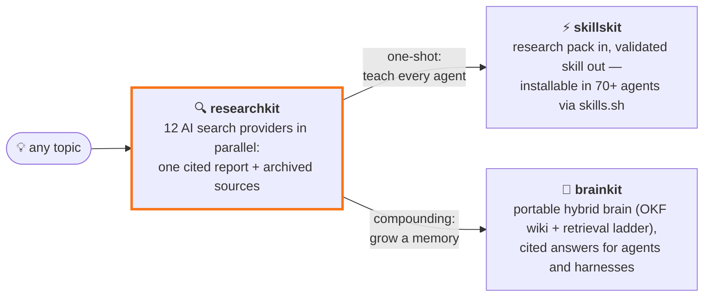

<p align="center">
  
</p>

# researchkit

> Command-line research tool (with MCP server and web UI) that fans one topic out to many AI web-search providers in parallel and merges the answers into a single citation-backed markdown report.

[](https://github.com/Paldom/researchkit/actions/workflows/ci.yml)


Every AI search provider sees a different slice of the web — and each will happily give you a confident, partial answer. researchkit asks OpenAI, Gemini, Grok, Perplexity (plus optional Tavily, Claude, GitHub, GLM, Kimi, Brave, OpenAlex, Exa) the same question at the same time, then synthesizes their findings into one report with sources you can check. One deliberate tradeoff: runs take a few minutes and spend API credits across providers — breadth over speed.



**One research run, two superpowers.** Ship the findings as an installable agent skill with [skillskit](https://github.com/Paldom/skillskit), or grow them into a portable, citation-backed brain with [brainkit](https://github.com/Paldom/brainkit).

## Quick start

Requires Python 3.11+ and [uv](https://docs.astral.sh/uv/).

```bash
git clone https://github.com/Paldom/researchkit && cd researchkit
uv sync --all-extras
cp .env.example .env    # add at least one provider API key
uv run researchkit "developer sentiment on AI coding agents" --days 7
```

Expected result: a progress log per provider, then a new `projects/<timestamp>_<topic>/` folder containing `report.md` (the cited report), `result.json`, and `run.log`, plus the handoff artifacts written once the research is in: `article.md` (a publication-ready article), `claims.jsonl` (one row per cited sentence, the handoff unit for brainkit and skillskit), `evidence.md` and `providers.md` (the report's appendices), `materials/` (the archived sources, downloaded _before_ the report is written) and `brain/` (a brainkit brain over those materials). `report.md` reads breadth-first: TL;DR, In brief, finding sections, Sources. Three Claude Code writer calls produce it: the body, then the lead and the article in parallel. Every article is then finished with the [`/deslop`](https://github.com/Paldom/noslop) and [`/illustrate`](https://github.com/Paldom/diagram-skills) skills, which are updated to their latest versions first: AI-writing tells are stripped without touching a citation, link or number (a pass that changes one is discarded), and an illustration lands in `article-assets/`, linked under the title. The pass runs Claude Code in an empty temp directory with an explicit tool allowlist and no web or MCP access; `RESEARCHKIT_ARTICLE_FINISH=0` skips it. The skill is made on request (`researchkit skill <project>`). So is a quality grade: `researchkit score <project>` checks `report.md` against the versioned rubric the writers are given (cited facts, dated numbers, both readings on conflict, open questions, no meta talk…) with one Claude Code judge call, and writes `rubric.json`. `researchkit verify <project>` labels every row of `claims.jsonl` against its archived source (`supported` / `unsupported` / `contradicted` / `unavailable`; an unarchived source is `unavailable`, never support) into `claims.labels.jsonl`. It only labels: the report and the claims are untouched. Providers without keys are skipped gracefully — one key is enough to try it.

## Use it from an AI agent (MCP)

The MCP server exposes researchkit as MCP tools any client can call:

```bash
claude mcp add researchkit -- uv run --directory /path/to/researchkit researchkit-mcp
```

or in a client config:

```json
{
  "mcpServers": {
    "researchkit": {
      "command": "uv",
      "args": ["run", "--directory", "/path/to/researchkit", "researchkit-mcp"]
    }
  }
}
```

Tools: `research(topic, days, providers, preset)` → markdown report (expect 1–5 minutes), `list_research_projects()`, `get_research_report(name)`.

## Web UI

A minimal React dashboard served by a FastAPI backend (replaces nothing you need for the CLI):

```bash
cd web && npm install && npm run build && cd ..
uv run researchkit-server
```

Open `http://127.0.0.1:8000` — submit a topic, watch live per-provider progress, read the rendered report, browse past runs. Each project has tabs for the report, the article, the skill (copy or download `SKILL.md`), and the brain — its index and every topic, report and source note, navigable by wiki-link — beside the prompt, raw JSON, links and log. The **Shared brain** field on the form feeds a run into a named brain (pick one or type a new name); the sidebar lists shared brains, creates one in advance and opens any of them, and a project's "add to brain…" box attaches an earlier run. The API is documented at `/api/docs`.

The server binds `127.0.0.1` and is unauthenticated by default. To expose it beyond localhost, set `RESEARCHKIT_AUTH_TOKEN` (clients send `Authorization: Bearer <token>`) — the server refuses to bind a non-loopback host without it.

## Subscription-only mode (no API keys)

If you're logged into the coding-agent CLIs — Claude Code, Codex, Antigravity (`agy`), the Grok CLI, and Kimi Code — researchkit can run entirely on those subscriptions, with zero API keys. The `harness` and `harness-fast` presets are `harness_only`: every LLM step runs on a CLI, and a run that would bill an LLM API is refused before it spends (search APIs such as Perplexity, Tavily and Exa stay allowed). Claude never has an API route in any preset — every Claude step is the Claude Code CLI on your claude.ai login, with `ANTHROPIC_API_KEY` and the other API/cloud switches stripped from its env:

```bash
uv run researchkit doctor                           # preflight: logins, model ids, keys — no tokens spent
uv run researchkit advise "is X a good idea?"       # every harness answers; you read them side by side
uv run researchkit council "is X a good idea?"      # lensed deliberation -> one boss-synthesized answer
uv run researchkit advise-session "q" ; ... --session <id>   # persistent, project-aware follow-ups
uv run researchkit explore "your topic" --days 7    # boosted research on CLI providers only
RESEARCHKIT_CLI_TIMEOUT=900 uv run researchkit explore "your topic" --preset harness-fast   # the same, time-boxed
```

| Command                                                                                            | What it does                                                                                                                                                                                                                                                                                                                                                                                                                                      | Typical time |
| -------------------------------------------------------------------------------------------------- | ------------------------------------------------------------------------------------------------------------------------------------------------------------------------------------------------------------------------------------------------------------------------------------------------------------------------------------------------------------------------------------------------------------------------------------------------- | ------------ |
| `advise "question"`                                                                                | Every harness answers the same question; you read the raw, un-synthesized comparison side by side. `--context-file notes.md` appends context.                                                                                                                                                                                                                                                                                                     | ~1–5 min     |
| `advise-session "q"`                                                                               | Same harnesses, but each answers inside a **persistent session** that reads the project and remembers the last turn. Returns one session id; follow up with `--session <id>`. Read-only file access.                                                                                                                                                                                                                                              | ~1–5 min     |
| `council "question"`                                                                               | Advisory deliberation: members answer through distinct lenses (practical / skeptic / tradeoffs), then a boss synthesizes one decisive answer with explicit **convergence and dissent**. `-v` appends every member's full answer.                                                                                                                                                                                                                  | ~2–10 min    |
| `explore "topic"`                                                                                  | Boost-mode research on the `harness` preset: the council refines and decomposes the topic, sub-investigations run across the five CLI providers plus the keyless Hacker News / skills.sh / OpenAlex providers (web search included), CLI-routed summaries end to end. Supports `--days`, `--materials`, `--ingest`. The web UI has the same thing as a "Harness only (no API keys)" toggle.                                                       | ~15–30 min   |
| `explore … --preset harness-fast` (the `explore-fast` skill; the preset declares its provider set) | The same pipeline, time-boxed. Providers run concurrently, so a run is as slow as its slowest member: the Codex research slot measured 30–55 min per call and Opus at max effort 11–17, while Antigravity, Grok CLI and Kimi finish in 1–4. `harness-fast` drops Codex from research and the council and lets Sonnet write the summaries; `RESEARCHKIT_CLI_TIMEOUT=900` turns any straggler into a dropped provider instead of an hour-long wait. | ~15–25 min   |

Defaults live in the `harness` preset in [`models.yaml`](models.yaml) (`claude:claude-opus-5-5` @xhigh, `codex:gpt-6.1-sol` @xhigh, `agy:gemini-3.8-flash-high`, `grokcli:grok-4.7`, `kimicli:kimi-code/k3`) — members, boss, models, and per-member `@<effort>` are all editable there, or per run via `--harnesses`/`--boss`/`--preset`. Site research stays off in these flows by default: Exa is a search API, which a `harness_only` preset allows (its summaries and keyword synthesis run on the CLI slots), but `explore` keeps the run zero-key. Every model spec follows the same `<harness>:<model>[@<effort>]` grammar — see the [models.yaml guide](docs/models-guide.md).

### The same commands, as Agent Skills

`advise`, `advise-max`, `advise-session`, `council`, `explore`, and `explore-fast` also ship as [Agent Skills](https://agentskills.io) under [`.claude/skills/`](.claude/skills/), next to the existing `researchkit` pipeline skill — so an agent can drive them (`/advise`, `/advise-max`, `/advise-session`, `/council`, `/explore`, `/explore-fast` in Claude Code from this repo); Codex and other Agent-Skills-standard agents discover the same skills via the repo's `.agents/skills/`. Install them into any of 70+ agents with the [skills CLI](https://skills.sh):

```bash
npx skills add Paldom/researchkit          # all detected agents
npx skills add Paldom/researchkit -a codex # or a specific agent
```

The skills wrap the CLI commands above and inherit the same guarantee: logged-in CLI subscriptions only, no API keys read.

## Archive the sources (materials)

Reports cite dozens of URLs; `--materials` (or the `materials` subcommand) downloads the pages themselves — SSRF-guarded, deduplicated, politely paced — into `projects/<run>/materials/` as frontmattered markdown plus an `index.json` manifest:

Materials are archived **by default**, and by default **every** cited source is fetched — the pack is what brainkit ingests and skillskit skillifies, and a truncated archive silently drops evidence the report cites. Opt out with `--no-materials`; cap a run with `--materials-limit N`. Pages are reduced to their main content (trafilatura, with a stdlib fallback for pages it can't read), and PDFs are archived from their text layer (pypdf; scanned or encrypted PDFs stay cited but link-only, as `pdf_unparsed`).

```bash
uv run researchkit "your topic"                           # research + archive every source (default)
uv run researchkit "your topic" --no-materials            # report only
uv run researchkit "your topic" --materials --boost       # boosted: each sub-project archives its own sources
uv run researchkit "your topic" --materials-limit 25      # cap the fetch at 25 sources
uv run researchkit materials <project>                    # archive an earlier run
```

Runs started from the web UI archive on the same terms — same default, same completeness.

In boost mode the cited URLs live in the sub-projects (the parent report cites the sub-reports, not the web), so materials are archived per sub-project. When a `--materials-limit` truncates a bigger citation set, the summary line says so and how to lift it. Every run prints an absolute `wrote: <path>` line, and `RESEARCHKIT_PROJECTS_DIR` pins output somewhere predictable for wrappers invoking via `uv run --directory`.

## Remote access over MCP

Run research on one machine — the one with the CLI subscriptions logged in —
and drive it from anywhere else. The MCP server speaks stdio by default (the
client spawns it) or Streamable HTTP, which is what makes it remote:

```bash
# on the research machine
uv run researchkit-mcp --http --host 0.0.0.0 --port 8765
```

Then point a client at it. Pick one:

```bash
# Claude Code
claude mcp add --transport http researchkit http://<host>:8765/mcp

# Codex CLI
codex mcp add researchkit --transport http --url http://<host>:8765/mcp
```

Claude Desktop / Cursor / anything reading a JSON config:

```json
{
  "mcpServers": {
    "researchkit": { "type": "http", "url": "http://<host>:8765/mcp" }
  }
}
```

Local-only (no network at all) — the client spawns the process itself:

```json
{ "mcpServers": { "researchkit": { "command": "researchkit-mcp" } } }
```

Verify with `claude mcp list`, or by hand:

```bash
curl -s -X POST http://<host>:8765/mcp \
  -H 'Content-Type: application/json' \
  -H 'Accept: application/json, text/event-stream' \
  -d '{"jsonrpc":"2.0","id":1,"method":"initialize","params":{"protocolVersion":"2025-11-25","capabilities":{},"clientInfo":{"name":"curl","version":"0"}}}'
```

### The tools

| Tool                                                     | What it does                                                                                |
| -------------------------------------------------------- | ------------------------------------------------------------------------------------------- |
| `explore_start(topic, days, materials)`                  | Starts a boosted subscription-only run, returns a `run_id` immediately                      |
| `explore_status(run_id)`                                 | status / stage / elapsed — poll this                                                        |
| `cancel_run(run_id)`                                     | stop a running explore: kills its harness CLIs, keeps what landed                           |
| `explore_report(run_id)`                                 | the super-summary once it's done                                                            |
| `research(topic, days, providers, preset)`               | One plain run, blocking (1–5 min)                                                           |
| `list_research_projects()` / `get_research_report(name)` | Read the archive on that machine                                                            |
| `get_research_artifact(name, artifact, note)`            | `article`, `skill`, `brain` (index or a note), `claims`, `materials` (manifest or one file) |

Explore is start/poll/read rather than one call because a run takes 15–40
minutes — far longer than any MCP client holds a tool call open. Run ids live
in memory, so a server restart forgets them; the finished projects are still on
disk.

### There is no authentication

By design — this is meant to be as simple as possible. What that means in
practice: **anyone who can reach the port can start research runs that spend
your subscription quota.** Two things reduce the blast radius:

- It binds `127.0.0.1` unless you pass `--host`, so it is local-only by default.
- `Host`/`Origin` are validated (DNS-rebinding defense), so a browser on your
  machine cannot be tricked into driving it. Reaching the server by a name it
  cannot guess — a tunnel or LAN hostname — needs
  `--allow-host name:port` (repeatable), or `--allow-host '*'` to turn the
  check off.

The recommended shape is a private tunnel rather than a public bind:

```bash
# on the research machine — loopback only
uv run researchkit-mcp --http --port 8765

# from the client machine
ssh -N -L 8765:127.0.0.1:8765 you@research-machine
claude mcp add --transport http researchkit http://127.0.0.1:8765/mcp
```

Tailscale works the same way: bind to the tailnet address and pass
`--allow-host <machine>.<tailnet>.ts.net:8765`. If you do expose it more
widely, put a reverse proxy with auth in front of it.

The `explore-remote` skill wraps all of this: it starts the run on the remote,
polls, and relays the write-up.

## Runaway protection

Every run holds one of a fixed number of slots while it collects from
providers, so no combination of terminals, web-UI requests, scripts or fan-outs
can put more than `RESEARCHKIT_MAX_CONCURRENT_RUNS` (default 10) runs on the
wire at once:

```bash
uv run researchkit runs        # what is collecting right now, and the cap
```

The slots live in `~/.researchkit/runs` and are claimed with `O_EXCL`, so the
ceiling holds **across processes** — the kernel picks the winner when two runs
race for the last slot. A slot whose owning process died (kill -9, crash,
reboot) is reclaimed by the next arrival, so a crash can't shrink the pool.

Three stages, in order: it **alerts** (log + `run_slots_high` progress event)
as the pool fills, **pauses** a run that finds no slot until one frees, and
only then **fails** it with `TooManyConcurrentRuns` naming the PIDs to check.
Tune with `RESEARCHKIT_MAX_CONCURRENT_RUNS` and `RESEARCHKIT_RUN_SLOT_WAIT_S`
(seconds to wait, default 300); `0` disables the cap. Note a boosted run takes
one slot per sub-query.

This complements the recursion guard: researchkit never invokes itself, so any
researchkit process started from inside a coding-agent CLI that researchkit
spawned is refused outright (`RESEARCHKIT_NESTED`).

## Mine the cited repositories

Runs cite GitHub repos — primary artifacts, not articles about artifacts.
Archiving one as an HTML page throws away everything worth having, so
researchkit clones each cited repo, reads it, and keeps the reading:

This runs **inside every run by default**: between provider collection and the
final analysis, so the extracts are evidence the report is written from, not a
sibling artifact nobody reads.

```bash
uv run researchkit run <project>                   # harvest + feed the analysis (default)
uv run researchkit run <project> --no-repos        # skip it
uv run researchkit run <project> --keep-clones     # keep the source trees too
uv run researchkit repos <project>                 # or after the fact, on a finished run
```

The step is bounded so it can never cost you a report you already paid for: 3
workers, 30s per repo, a 90-second hard deadline, top 5 cited repos, running
beside the archive download. Whatever finished by the deadline is used, a
clone still running is killed at it, and the run says so
(`Repository grounding: 3/5 harvested, 2 unavailable in time`). Nothing in it
can raise.

Only a compact card per repo reaches the analysis prompt — manifest facts,
structure, public surface, a documentation lead — wrapped in the same
untrusted-data delimiters as provider text, with the precedence stated: a
repository is authoritative about _itself_, and its README's claims about the
wider field are claims, not corroboration. The full extract stays on disk under
`repos/`, and a copy (`materials/repo-<owner>-<name>.md`) is listed in
`materials/index.json` with `origin: repo_extract`, so one manifest describes
the whole pack and names only files inside `materials/` — the contract brainkit
fails closed on.

Each repo becomes `projects/<run>/repos/<owner>-<name>.md` holding its package
manifest (name, description, dependencies), its documentation (README plus
`docs/`, within a budget), its public surface (exported functions, classes),
and its directory shape — then **the clone is deleted**. A source tree is the
bulkiest thing a pack can carry and the least re-readable later; the extract is
a few hundred KB an agent can load, and the URL is right there when you want
the code itself. `psf/requests` and `sindresorhus/slugify` together came to 68 KB.

Tests count toward the structure but are excluded from the docs and the public
surface — harvesting them filled the whole API budget with `conftest` helpers
and pushed the real documentation out. The extracts carry the same flat
frontmatter as `materials/`, so brainkit ingests them without special-casing,
and `repos/SUMMARY.md` indexes the set with a model's take on what they
contribute to the topic.

The clone is removed only after its extract is written, so a failed write
leaves the tree rather than losing the repo.

## Resume an interrupted run

Each provider's answer is written to `projects/<run>/partial/<provider>.json` the moment it lands, so a run that is killed keeps everything it already paid for. Re-running the project reuses those answers instead of buying them twice:

```bash
uv run researchkit run <project>               # resumes from partial/ (default)
uv run researchkit run <project> --no-resume   # re-query every provider
```

The run prints which providers it is reusing. `partial/` is deleted once `result.json` supersedes it.

## Build a brain from your research

Every run already carries its own brain: once the materials are archived, `projects/<run>/brain/` is built with [brainkit](https://github.com/Paldom/brainkit) when it is installed in the environment (`uv pip install -e ../brainkit --python .venv/bin/python`) — a topic note, one note per archived source, the report's sections, and an `index.md` to descend from. The web UI's Brain tab browses it; `brainkit --brain projects/<run>/brain search "question"` queries it. A boosted run gets one, on the parent, over the whole study (brainkit recurses into `subprojects/`); each sub-project archives its own citations during its run. `researchkit materials <run> --refresh` rebuilds it.

**Shared brains** let many runs feed one brain. Create it in advance, point runs at it, attach earlier runs later; a run with `--brain` also starts from what the brain already knows (matching source notes join the evidence as citable "(earlier research)" sources, the web search still runs):

```bash
uv run researchkit brain create team-notes          # under ~/.researchkit/brains (RESEARCHKIT_BRAINS_DIR)
uv run researchkit "your topic" --brain team-notes  # research, then ingest into it
uv run researchkit brain add team-notes projects/<earlier-run>
uv run researchkit brain list                       # runs and notes per brain
```

The web UI, the HTTP API (`/api/brains`) and the MCP server (`research(brain=…)`, `list_brains`, `brain_context`) take the same brain names.

Beyond one run, pair researchkit with brainkit to turn any number of runs into a portable, citation-backed knowledge base that AI agents can query later — every answer traces back to a research run and a source URL:

```bash
# side-by-side checkouts
git clone https://github.com/Paldom/researchkit && git clone https://github.com/Paldom/brainkit
cd researchkit

uv run researchkit "your topic" --materials    # 1. research + archive cited pages

uv run --directory ../brainkit brainkit --brain ../brainkit/brain \
  ingest "$(pwd)/projects/<run-folder>"        # 2. turn the run into brain notes

uv run --directory ../brainkit brainkit --brain ../brainkit/brain \
  search "your question"                       # 3. cited answers, any time later
```

Or hand off in one shot: with brainkit installed into researchkit's environment (`uv pip install -e ../brainkit --python .venv/bin/python`), `--ingest <brain-dir>` runs the whole pipeline — research, archive, ingest — in a single command:

```bash
uv run --no-sync researchkit "your topic" --materials --ingest ../brainkit/brain
```

Boosted runs ingest fully too: brainkit recurses into `subprojects/`, so every sub-investigation lands as its own topic with its own cited sources. Ingest as many runs as you like into one brain — sources cited by several researches merge into single notes. In [Claude Code](https://claude.com/claude-code), both repos ship skills (`.claude/skills/`) so agents drive this pipeline and answer from the brain with citations on their own.

## Features

- Queries up to 12 AI search providers concurrently; one slow or failing provider never blocks the rest
- `researchkit doctor` preflights a preset before any spend: harness logins, pinned model ids, per-slot API keys — drift fails in seconds, not mid-run
- Every finished run is a versioned research pack ([docs/research-pack.md](docs/research-pack.md)) that brainkit ingests and skillskit skillifies; the run footer prints both next steps
- Cross-provider synthesis: per-provider summaries plus one consolidated, citation-backed analysis
- Recency window (`--days`) keeps results to fresh content; social and web sources are queried separately
- Project folders make every run reproducible and diffable (`config.json`, `result.json`, `report.md`, `run.log`)
- LLM council mode (`--boost`) has multiple models refine the topic, then fans hard questions out into parallel sub-investigations with a super-summary
- Model presets in [`models.yaml`](models.yaml) switch the whole pipeline between quality/cost tradeoffs (`--preset optimal` for the benchmarked cheap-and-fast setup)

## Configuration

Each provider sees a different slice of the web — that's the point of running them together. Source volumes and domain profiles below come from ~290 logged research runs and a 14-run benchmark.

| Provider        | Env var                              | Default?                                            | What it adds                                                                                                                                                                                                                                                                  |
| --------------- | ------------------------------------ | --------------------------------------------------- | ----------------------------------------------------------------------------------------------------------------------------------------------------------------------------------------------------------------------------------------------------------------------------- |
| OpenAI          | `OPENAI_API_KEY`                     | yes                                                 | Agentic multi-step web search with domain filtering; steady mid-volume citer (median ~50 sources/run) skewing Reddit, GitHub, arXiv, news                                                                                                                                     |
| Gemini          | `GEMINI_API_KEY`                     | yes                                                 | The only first-party Google Search grounding; near 1:1 citation-to-retrieval ratio (researchkit resolves its redirect URLs to real sources)                                                                                                                                   |
| Grok (xAI)      | `XAI_API_KEY`                        | yes                                                 | Native X/Twitter search and the highest volume of any provider (median ~110 sources/run); the go-to for social pulse — X, Reddit, TikTok. No API key? `grok: grokcli` in `models.yaml` routes it through the official Grok CLI on grok.com-subscription billing               |
| Perplexity      | `PERPLEXITY_API_KEY`                 | yes                                                 | Search-first LLM tuned for fresh news and media; the strongest YouTube/Instagram/Facebook coverage of the API providers                                                                                                                                                       |
| Tavily          | `TAVILY_API_KEY`                     | opt-in                                              | LLM-optimized raw search: a deterministic ~40 clean sources per run, zero failures across 149 logged runs — breadth without another model's opinions                                                                                                                          |
| Claude          | Claude Code subscription             | opt-in                                              | Agentic multi-step research via the `claude` CLI — subscription only, never the Anthropic API; strongest on developer forums (Hacker News, dev.to) and the only other provider citing X                                                                                       |
| GitHub          | `GITHUB_TOKEN`                       | opt-in                                              | Developer ground truth: real repos, issues and PRs (~95% of its citations are github.com) — primary artifacts, not summaries. A CLI spec in its slot (`github: codex:<model>`) drops the OpenAI-API web search and analyzes on the harness                                    |
| GLM (Z.ai)      | `GLM_API_KEY`                        | opt-in                                              | Budget generalist: cheap and reliable but capped at ~20 sources with no distinctive domains — best as an inexpensive analysis/summarizer slot                                                                                                                                 |
| Kimi (Moonshot) | `KIMI_API_KEY`                       | opt-in                                              | Moonshot's official web-search tool (Formula API) runs server-side searches mid-completion (no structured citations — sources recovered from inline links). No API key? `kimi: kimicli` in `models.yaml` routes it through the Kimi Code CLI on kimi.com-subscription billing |
| Exa             | `EXA_API_KEY`                        | opt-in via `--providers`; also powers site research | Embeddings-first neural search: finds semantically related pages that keyword search misses, with full-text retrieval for deep reading — registered both as a provider (like Tavily) and as the site-research connector                                                       |
| Brave           | `BRAVE_API_KEY`                      | opt-in via `--providers`                            | The only large independent English index (not Google/Bing-derived) plus a discussions vertical for forum/Reddit threads — catches what both big indexes miss. Sequentially paced for starter-tier rate limits; cheap tier requires public attribution                         |
| OpenAlex        | keyless (`OPENALEX_MAILTO` optional) | opt-in via `--providers`                            | Peer-reviewed literature with DOIs, venues, and citation counts. Self-gating: when the topic has no matching scholarly works it reports "not relevant" with zero sources instead of padding the report with off-topic papers                                                  |
| Hacker News     | keyless                              | opt-in via `--providers`                            | Developer consensus scored by upvotes rather than relevance: stories and comment counts from the Algolia HN index, windowed by `--days` and ranked by points                                                                                                                  |
| skills.sh       | keyless                              | opt-in via `--providers`                            | The Agent Skills directory ranked by real install counts — what agents are actually being taught to do. Self-gates to "not relevant" when a topic has no matching skills                                                                                                      |
| arXiv           | keyless                              | opt-in via `--providers`                            | Preprints, where fast-moving research lands months before peer review indexes it. Complements OpenAlex (published works) rather than replacing it                                                                                                                             |
| Stack Exchange  | keyless (300 req/day anonymous)      | opt-in via `--providers`                            | What practitioners got stuck on and which answer worked, scored by votes and accepted answers — the complement to HN's argument                                                                                                                                               |

All keys live in `.env` (see [`.env.example`](.env.example)). Model choices, presets, budgets, and advanced CLI-backed modes are documented in [`models.yaml`](models.yaml).

## Plugins

Providers and site-research connectors are **plugins**: the twelve built-in
providers (Exa doubles as the site-research connector) register through the same registry that
external plugins use, so anything you install behaves exactly like a
built-in. Activation is key-based — installing a plugin package and setting
the API key it declares is all it takes; no config ceremony:

```bash
# inside your own project (recommended): the dep lands in YOUR manifest
uv add "researchkit-plugin-example @ git+ssh://git@github.com/you/researchkit-plugin-example@v0.1.0"
echo 'EXAMPLE_API_KEY=…' >> .env
uv run researchkit plugins # → researchkit-plugin-example 0.1.0 [active]
```

`researchkit plugins` shows every installed plugin with its activation
status (`inactive (set EXAMPLE_API_KEY to activate)` when a key is
missing), version, and install origin. Every research run records the
active plugin versions in `result.json` — provenance over promises.

**Safety model, honestly:** a plugin is Python running in your process — no
sandbox; installing a package is the trust decision. researchkit adds
key-based activation (nothing runs uninvited), per-plugin quarantine (one
broken plugin can't take down a run or other plugins), API-version
handshake, name-collision rejection, and two rails:
`RESEARCHKIT_NO_PLUGINS=1` (kill switch) and
`RESEARCHKIT_PLUGINS=dist-a,dist-b` (exact allowset).

### Writing a plugin

A plugin is a normal package with one entry point returning a manifest.
Complete connector plugin, ~30 lines:

```toml
# pyproject.toml
[project]
name = "researchkit-plugin-example"
version = "0.1.0"
requires-python = ">=3.11"
dependencies = ["researchkit"]

[project.entry-points."researchkit.plugins"]
example = "researchkit_plugin_example.plugin:MANIFEST"

[build-system]
requires = ["hatchling"]
build-backend = "hatchling.build"
```

```python
# researchkit_plugin_example/plugin.py
from researchkit.plugin_api import (
    BaseSiteConnector, ConnectorContext, ConnectorSpec, PluginManifest,
    SiteItem, SiteItemSummary,
)

class ExampleConnector(BaseSiteConnector):
    site_name = "example"
    def search(self, query, published_after, limit):
        return [SiteItem(site="example", query=query, title="…", url="…",
                         content="full text here", content_kind="article")]
    def summarize(self, topic, item):
        return SiteItemSummary(tldr=["…"])
    def popularity_score(self, item):
        return 0.0

MANIFEST = PluginManifest(
    api_version=1,
    connectors=(ConnectorSpec("example", lambda ctx: ExampleConnector(),
                              requires_env=("EXAMPLE_API_KEY",)),),
)
```

Rules that keep everyone sane:

- **Import only `researchkit.plugin_api`** — everything else is private and
  will change. `ProviderSpec` works the same way for research providers
  (set `is_llm`/`supports_improver` capabilities honestly).
- **Fill `SiteItem.content` (+ `content_kind`: `article`/`transcript`/
  `summary`) when your platform's pages can't be fetched generically** —
  the materials archive stores it directly and never re-queries your API.
  Plugins hand data to core; core writes all files.
- Site research runs against **every active connector by default** —
  installing a connector plugin (plus its key) is all it takes for its
  results to appear in runs, reports, and the materials archive. Set
  `default_enabled=False` on a `ConnectorSpec` for connectors that log in,
  scrape walled or ToS-restricted sites, or rarely earn a citation: they
  stay installed and selectable (`--sites NAME`, the UI's site list) but
  never start on their own. The bundled youtube, medium, substack and
  stealth (webui, linkedin, medium_stealth) plugins run by default.
- Optional hooks: `search_batch` (replaces per-keyword search),
  `summarize_batch` (adds a digest section), `popularity_label` (report
  display like `Views: 1.2M`), `sequential = True` (hard rate limits),
  `needs_keywords = False` (works from the topic alone, so it starts with
  the providers instead of after keyword synthesis).
- Every connector runs concurrently with the others and with the provider
  phase where it can; `sequential` only orders a connector's own queries.
  A connector that holds a resource nobody can share (one browser profile,
  say) serializes on it itself.
- Configure per-plugin options in a preset's `plugins:` block and a model
  via a `models: {example: some-model}` key; both arrive in your factory's
  context.

### Developing against a researchkit checkout

Never `uv add` a plugin inside this repo (it would edit the committed
manifests — CI rejects it). Install editables venv-only, targeting the
project venv explicitly, and skip the pruning sync when running:

```bash
uv pip install --python .venv/bin/python -e . -e ../researchkit-plugin-example
uv run --no-sync researchkit plugins
```

(`uv run` without `--no-sync` restores the lockfile state and removes
venv-only installs; `local-plugins/` and `local-plugins.txt` are gitignored
scratch conventions for this workflow.)

## Development

```bash
uv sync --all-extras && uv run pre-commit install
uv run ruff check . && uv run ruff format --check . && uv run mypy src && uv run pytest --cov -q
```

Agent-assisted contributions are expected here — the repo ships guardrails and conventions in [AGENTS.md](AGENTS.md).

## Contributing

Contributions welcome — see [CONTRIBUTING.md](CONTRIBUTING.md). Security reports: [SECURITY.md](SECURITY.md).

## License

MIT — see [LICENSE](LICENSE). Changes are tracked in [CHANGELOG.md](CHANGELOG.md).
